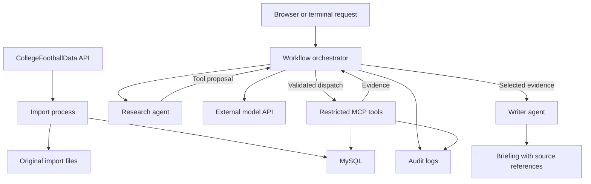

# Stillwater / Game Day 🏈

A Texas Longhorns football briefing app exploring historical data ingestion, multi-agent AI workflows, MCP tools, and secure access to MySQL.

This is the first project in **Project Stillwater**, a collection of hands-on projects exploring AI systems and secure software architecture. Developed collaboratively with OpenAI Codex, it combines AI-assisted planning, implementation, and review with human direction and verification. The goal is to build something useful while documenting the architecture, permissions, and engineering tradeoffs behind it.

## Status

**November 18:** the working local web/terminal version is on `main`. Guided review and the [initial threat model](docs/deployment-threat-model.md) are complete. Next is staged deployment: app/MCP on Smaug alongside the existing static site, MySQL on Rivendell. Owner permission and sudo are confirmed; remote configuration, runtime isolation, and backups remain unverified. See the [deployment runbook](docs/deployment-runbook.md).

**Local data preparation and database schema are working.** CFBD source checks and offline normalization passed. MySQL 8.4.13 runs in Docker locally, with the four-table schema applied and representative database constraints verified. Real imports now contain 15 teams, 14 games, and 28 team-game statistics rows; repeated imports retained counts and IDs, and a controlled-failure rollback restored the dataset.

The importer has passed offline tests and local MySQL integration. The two bounded MCP tools are implemented and verified over stdio; the research/writer workflow has produced a verified live sample and passed the scoped missing-statistics and injected-text evaluations. The import identity has passed required write and denied-operation checks. MCP read-only views/grants are implemented and their allowed/denied checks passed, including populated view counts after import. The two-agent briefing and recorded demo are complete. See [local database checks](docs/local-database-checks.md) and the [importer review](docs/importer-review.md).

## Project Goal

Build a terminal-based working prototype in approximately two weeks / 20–30 focused hours that:

- Imports historical football data from CollegeFootballData (CFBD), starting with Texas’s 2023 season and expanding coverage as time permits.
- Stores normalized data and source references in MySQL.
- Uses a research agent to retrieve facts through restricted MCP tools.
- Uses a writer agent to produce a briefing with evidence references.
- Demonstrates permitted access, blocked access, and handling of untrusted instructions.

Exact dataset coverage will depend on source availability, permitted use, and implementation time.

Version one uses CFBD as its single historical data source and a fixed sequential workflow. Live ingestion, a dashboard, S3, Athena, RDS, arbitrary SQL or shell tools, and infrastructure-changing agents are deferred. Reduce data coverage before expanding scope.

## Local Architecture and Planned Deployment



The demo ran locally on the developer’s Mac. MySQL is the selected database: the current instance is MySQL 8.4.13 in Docker, with persistent storage in the Compose `mysql_data` volume and a published port restricted to `127.0.0.1:3307`. Local Python code will connect through that port. The older host MySQL 5.7 installation is untouched.

Deployment is planned across the friend’s two Linux VMs: app/MCP on Smaug and MySQL on Rivendell. Both are ready and setup is authorized; Smaug’s existing static site must be preserved. Remote access uses Tailscale/SSH. No deployment changes have occurred; capacity, network controls, and recovery must be inspected. OpenAI `gpt-6-luna` with low reasoning effort is selected; live API access is verified.
The research agent retrieves structured evidence through `list_games` and `get_game_data`. The writer receives that evidence and its source references without database or retrieval-tool access. The orchestrator controls the handoff, timeouts, and usage limits.

## Data Plan

CollegeFootballData (CFBD) is selected for schedules, game results, and core team game statistics. The initial sample covers Texas’s 2023 season: 14 games and 28 team-game statistics records. Schedule/results checks and selected official box-score comparisons are documented in the [source validation report](docs/source-validation.md); full statistical accuracy across every game has not been established. Return and detailed defensive statistics are deferred, including a documented kickoff-return discrepancy. Validate the repeatable database import before expanding historical coverage. Add player statistics if time and source coverage allow.

Imports will preserve original source files and track retrieval time, record counts, and failures. Repeat imports should update existing records without creating duplicates.

Keep original imports in a private local directory excluded from Git. Link normalized records to their source and import history, and preserve missing values as missing rather than treating them as zero.

## Security Approach

- Separate database identities for administration, ingestion, and retrieval.
- Give the MCP database identity read-only access to individually approved views.
- Keep database credentials out of agent inputs and outputs; keep import and administrator credentials unavailable to the agent runtime.
- Expose bounded, parameterized retrieval tools rather than arbitrary SQL.
- Keep local MySQL loopback-only; for the two-VM deployment, restrict the private database path to the intended app host and verify database authentication/grants independently.
- Exclude credentials, private configuration, and sensitive logs from Git.
- Treat retrieved notes as untrusted data.
- Record sanitized audit events, errors, timing, and model usage without exposing secrets in prompts or logs.

A controlled live prompt-injection experiment in an in-memory copy of venue text passed one observed attempt. Live missing-statistics evaluation also passed after a sparse-data validation fix. Separate database checks previously verified authorized reads and denied private/base-table reads and writes. Repeated imports retained dataset identities and counts. These scoped checks do not constitute a complete security audit; see [security/failure results](docs/security-failure-checks.md).

Database identities enforce database privileges, but services on one machine still share host-level risks. Separate operating-system users or containers may improve isolation; the implementation will document the limits of the chosen setup.

## Two-Week Milestones

| Days | Focus |
|---|---|
| 1–2 | Environment setup, source selection, schema, and permissions |
| 3–5 | Historical data ingestion and validation |
| 6–7 | MCP retrieval tools |
| 8–10 | Research and writer agents, sourced briefings, and logging |
| 11–12 | Security and failure-handling checks |
| 13–14 | Documentation, fixes, and demo |

## Definition of Done

- A repeatable import loads the agreed dataset and reports gaps.
- Two agents produce a briefing through restricted tools.
- Factual claims can be traced to source records.
- Missing information is reported rather than invented.
- Authorized reads succeed; unauthorized reads and writes fail.
- Sanitized logs make tool calls and workflow outcomes inspectable.
- Setup instructions, a sample sourced briefing, security-check results, and isolation limitations are documented.

## Development Setup

Design references: [schema draft](db/schema-draft.sql), [permission plan](docs/permissions.md), and [source validation](docs/source-validation.md). The schema is applied locally with representative constraints tested; MCP view-only privileges are implemented and tested, while import-account grants are verified and runtime OS isolation remains pending.

See the [project outline](docs/project-outline.md) for the detailed plan, security boundaries, learning approach, and next three implementation steps.

Python 3.13 is selected for implementation. Local setup has been verified with Python 3.13.16 on an Intel Mac. CFBD is the selected football data source. OpenAI `gpt-6-luna` with low reasoning effort is selected for initial evaluation; live access and the initial scoped evaluations have passed. Local MySQL startup, administrator authentication, and schema checks have passed; MCP account checks passed; import-account authorization checks also passed.

From the repository root, create and activate a project-specific virtual environment:

```bash
python3.13 -m venv .venv
source .venv/bin/activate
python --version
python -m pip --version
```

Create the environment once; activate it again in each new development terminal. The pip path should be inside this repository’s `.venv/`. Use `python -m pip` for package installation so it uses the selected interpreter. Install the pinned database connector with `python -m pip install -r requirements.txt`.

In VS Code, install the Python extension by Microsoft (`ms-python.python`), then run **Python: Select Interpreter** and choose `.venv/bin/python`.

Verify the terminal interpreter with:

```bash
python -c "import sys; print(sys.executable); print('Stillwater is ready')"
```

The executable path should point inside `.venv/`. The environment and generated Python bytecode are excluded from Git; dependencies will be declared separately so the environment can be recreated. Run `deactivate` to leave the environment.

The research → writer implementation passes offline tests and real MCP/database integration; a live sample and scoped missing-data/injected-text cases passed. See the [sample briefing](docs/sample-briefing.md) and [security/failure results](docs/security-failure-checks.md). See the [model review](docs/model-review.md) before enabling paid calls. See the [MCP review](docs/mcp-review.md) for implemented guardrails and test results. See the [checkpoint summary](docs/checkpoint-summary.md) and [credential inventory](docs/credentials.md).

## Learning Notes

This repository will document architectural decisions, security-check results, and lessons learned. AI coding tools will assist development; changes will be reviewed and verified as part of the learning process.

Work in small steps: explain → try → inspect → review the diff → commit. Connect new concepts to familiar Java/MySQL work and verify both expected behavior and relevant failures.

The working Python-served web UI and terminal fallback are merged into `main`. The demo and guided review are complete; future improvements should use new branches from `main`. See the [post-demo learning plan](docs/post-demo-learning-plan.md) for proposed next steps.

## Local Browser Demo

Run `python scripts/web_app.py` and open http://127.0.0.1:8000 for a preview and saved sample. Restart with `--live` to enable paid generation from the button. The implementation uses Python plus plain HTML/CSS/JavaScript; no React or Node setup. See [web UI setup and security boundaries](docs/web-ui.md). Initial manual UI review is complete; automated browser, responsive-layout and systematic keyboard checks remain unverified.

The browser search accepts reviewed opponent aliases and season game numbers, with clarification for ambiguous inputs such as UW. No runtime internet search is used. See [UI behavior, review history, and security](docs/web-ui.md) and the [sourced alias catalog](docs/team-aliases.md).

Reviewed aliases now include team nicknames such as Cougs and Cowpokes. Shared labels (Cowboys, Pokes, Cougars) require clarification; see the [catalog and collision rules](docs/team-aliases.md).

For a component-by-component walkthrough with Mermaid diagrams, code links, security boundaries and evidence limits, see the [glass-to-metal architecture review](docs/glass-to-metal-review.md).

The writer now prefers broader statistical coverage when available, while preserving the 1–6 claim limit and sparse-data handling. A live Alabama check produced five evidence-matching claims (four requests, 8,684 reported tokens); Ry reported the richer output was better. See the [presenter outline](docs/demo-outline.md) for a roughly 3–4 minute explanation after the product demo.
