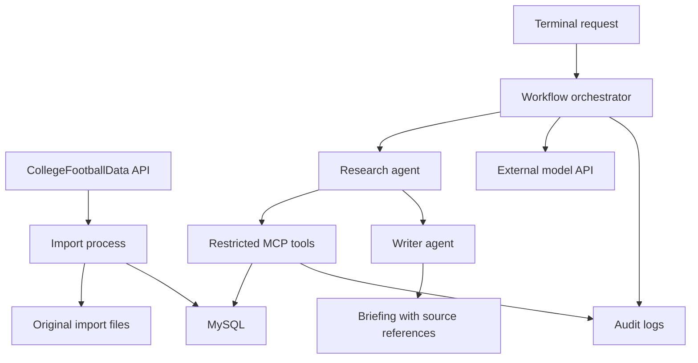

# Stillwater / Game Day 🏈

A Texas Longhorns football briefing app exploring historical data ingestion, multi-agent AI workflows, MCP tools, and secure access to MySQL.

This is the first project in **Project Stillwater**, a collection of hands-on projects exploring AI systems and secure software architecture. Developed collaboratively with OpenAI Codex, it combines AI-assisted planning, implementation, and review with human direction and verification. The goal is to build something useful while documenting the architecture, permissions, and engineering tradeoffs behind it.

## Status

**Local data preparation and database schema are working.** CFBD source checks and offline normalization passed. MySQL 8.4.13 runs in Docker locally, with the four-table schema applied and representative database constraints verified. Real imports now contain 15 teams, 14 games, and 28 team-game statistics rows; repeated imports retained counts and IDs, and a controlled-failure rollback restored the dataset.

The importer has passed offline tests and local MySQL integration. The two bounded MCP tools are implemented and verified over stdio; the research/writer implementation passes fake-model tests, while live model behavior and a generated briefing remain pending. The import identity has passed required write and denied-operation checks. MCP read-only views/grants are implemented and their allowed/denied checks passed, including populated view counts after import. The two-agent briefing is required for the Saturday demo. See [local database checks](docs/local-database-checks.md) and the [importer review](docs/importer-review.md).

## Project Goal

Build a terminal-based working prototype in approximately two weeks / 20–30 focused hours that:

- Imports historical football data from CollegeFootballData (CFBD), starting with Texas’s 2023 season and expanding coverage as time permits.
- Stores normalized data and source references in MySQL.
- Uses a research agent to retrieve facts through restricted MCP tools.
- Uses a writer agent to produce a briefing with evidence references.
- Demonstrates permitted access, blocked access, and handling of untrusted instructions.

Exact dataset coverage will depend on source availability, permitted use, and implementation time.

Version one uses CFBD as its single historical data source and a fixed sequential workflow. Live ingestion, a dashboard, S3, Athena, RDS, arbitrary SQL or shell tools, and infrastructure-changing agents are deferred. Reduce data coverage before expanding scope.

## Planned Architecture



The Saturday demo will run locally on the developer’s Mac. MySQL is the selected database: the current instance is MySQL 8.4.13 in Docker, with persistent storage in the Compose `mysql_data` volume and a published port restricted to `127.0.0.1:3307`. Local Python code will connect through that port. The older host MySQL 5.7 installation is untouched.

After the demo, deployment is planned to the friend’s Linux VMs, with the app and MySQL together on the new VM as the preferred arrangement. VM availability, capacity, final topology, and permissions for application installs remain unconfirmed. MySQL setup on the new VM is authorized. Remote access is planned through Tailscale/SSH with MagicDNS; no remote setup has occurred. OpenAI `gpt-6-luna` with low reasoning effort is selected; live API access is not yet verified.
The planned research agent will retrieve structured evidence through `list_games` and `get_game_data`. The writer will receive that evidence and its source references without database or retrieval-tool access. The orchestrator will control the handoff, timeouts, and usage limits.

## Data Plan

CollegeFootballData (CFBD) is selected for schedules, game results, and core team game statistics. The initial sample covers Texas’s 2023 season: 14 games and 28 team-game statistics records. Schedule/results checks and selected official box-score comparisons are documented in the [source validation report](docs/source-validation.md); full statistical accuracy across every game has not been established. Return and detailed defensive statistics are deferred, including a documented kickoff-return discrepancy. Validate the repeatable database import before expanding historical coverage. Add player statistics if time and source coverage allow.

Imports will preserve original source files and track retrieval time, record counts, and failures. Repeat imports should update existing records without creating duplicates.

Keep original imports in a private local directory excluded from Git. Link normalized records to their source and import history, and preserve missing values as missing rather than treating them as zero.

## Security Approach

- Separate database identities for administration, ingestion, and retrieval.
- Give the planned MCP database identity read-only access to individually approved views.
- Keep database credentials out of agent inputs and outputs; keep import and administrator credentials unavailable to the agent runtime.
- Expose bounded, parameterized retrieval tools rather than arbitrary SQL.
- Keep MySQL accessible only within the host or private container network.
- Exclude credentials, private configuration, and sensitive logs from Git.
- Treat retrieved notes as untrusted data.
- Record sanitized audit events, errors, timing, and model usage without exposing secrets in prompts or logs.

A controlled prompt-injection experiment in a harmless game note will test agent behavior. Separate database checks will verify that authorized reads succeed, private-table reads fail, and dataset writes fail under the MCP identity. Missing-data and repeated-import checks will verify application behavior and data integrity.

Database identities enforce database privileges, but services on one machine still share host-level risks. Separate operating-system users or containers may improve isolation; the implementation will document the limits of the chosen setup.

## Two-Week Milestones

| Days | Focus |
|---|---|
| 1–2 | Environment setup, source selection, schema, and permissions |
| 3–5 | Historical data ingestion and validation |
| 6–7 | MCP retrieval tools |
| 8–10 | Research and writer agents, sourced briefings, and logging |
| 11–12 | Security and failure-handling checks |
| 13–14 | Documentation, fixes, and demo |

## Definition of Done

- A repeatable import loads the agreed dataset and reports gaps.
- Two agents produce a briefing through restricted tools.
- Factual claims can be traced to source records.
- Missing information is reported rather than invented.
- Authorized reads succeed; unauthorized reads and writes fail.
- Sanitized logs make tool calls and workflow outcomes inspectable.
- Setup instructions, a sample sourced briefing, security-check results, and isolation limitations are documented.

## Development Setup

Design references: [schema draft](db/schema-draft.sql), [permission plan](docs/permissions.md), and [source validation](docs/source-validation.md). The schema is applied locally with representative constraints tested; MCP view-only privileges are implemented and tested, while import-account grants are verified and runtime OS isolation remains pending.

See the [project outline](docs/project-outline.md) for the detailed plan, security boundaries, learning approach, and next three implementation steps.

Python 3.13 is selected for implementation. Local setup has been verified with Python 3.13.16 on an Intel Mac. CFBD is the selected football data source. OpenAI `gpt-6-luna` with low reasoning effort is selected for initial evaluation; account access and live behavior remain unverified. Local MySQL startup, administrator authentication, and schema checks have passed; MCP account checks passed; import-account authorization checks also passed.

From the repository root, create and activate a project-specific virtual environment:

```bash
python3.13 -m venv .venv
source .venv/bin/activate
python --version
python -m pip --version
```

Create the environment once; activate it again in each new development terminal. The pip path should be inside this repository’s `.venv/`. Use `python -m pip` for package installation so it uses the selected interpreter. Install the pinned database connector with `python -m pip install -r requirements.txt`.

In VS Code, install the Python extension by Microsoft (`ms-python.python`), then run **Python: Select Interpreter** and choose `.venv/bin/python`.

Verify the terminal interpreter with:

```bash
python -c "import sys; print(sys.executable); print('Stillwater is ready')"
```

The executable path should point inside `.venv/`. The environment and generated Python bytecode are excluded from Git; dependencies will be declared separately so the environment can be recreated. Run `deactivate` to leave the environment.

The research → writer implementation passes fake-model tests, including real local MCP/database retrieval; live model integration and quality checks remain pending. See the [model review](docs/model-review.md) before enabling paid calls. See the [MCP review](docs/mcp-review.md) for implemented guardrails and test results. See the [checkpoint summary](docs/checkpoint-summary.md) and [credential inventory](docs/credentials.md).

## Learning Notes

This repository will document architectural decisions, security-check results, and lessons learned. AI coding tools will assist development; changes will be reviewed and verified as part of the learning process.

Work in small steps: explain → try → inspect → review the diff → commit. Connect new concepts to familiar Java/MySQL work and verify both expected behavior and relevant failures.
