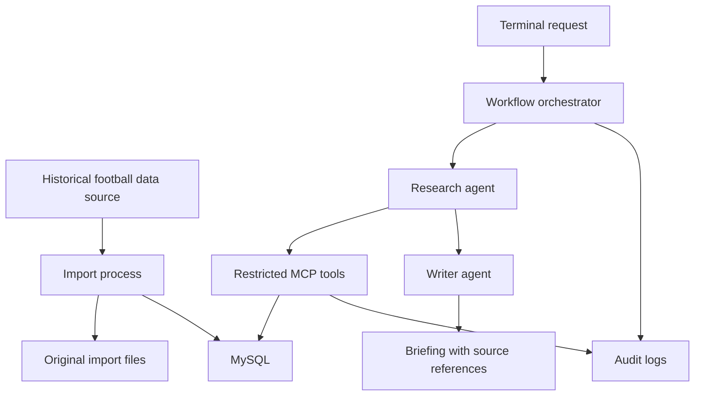

# Stillwater / Game Day 🏈

A Texas Longhorns football briefing app exploring historical data ingestion, multi-agent AI workflows, MCP tools, and secure access to MySQL.

This is the first project in **Project Stillwater**, a collection of hands-on projects exploring AI systems and secure software architecture. Developed collaboratively with OpenAI Codex, it combines AI-assisted planning, implementation, and review with human direction and verification. The goal is to build something useful while documenting the architecture, permissions, and engineering tradeoffs behind it.

## Status

**Planning and initial setup.** Features below describe the intended implementation.

## Project Goal

Build a working prototype in approximately two weeks that:

- Imports multiple seasons of historical football data from one suitable source.
- Stores normalized data and source references in MySQL.
- Uses a research agent to retrieve facts through restricted MCP tools.
- Uses a writer agent to produce a briefing with evidence references.
- Demonstrates permitted access, blocked access, and handling of untrusted instructions.

Exact dataset coverage will depend on source availability, permitted use, and implementation time.

## Planned Architecture

The initial application and database will run on an EC2 sandbox, accessed through Tailscale. The orchestrator will invoke an external model API and run the research and writing stages sequentially.

## Data Plan

Start with schedules, game results, and team game statistics. Add player statistics if time and source coverage allow.

Imports will preserve original source files and track retrieval time, record counts, and failures. Repeat imports should update existing records without creating duplicates.

## Security Approach

- Separate database identities for administration, ingestion, and retrieval.
- Give the MCP database identity read-only access to approved tables or views.
- Keep database credentials out of agent inputs and outputs.
- Expose bounded, parameterized retrieval tools rather than arbitrary SQL.
- Keep MySQL accessible only within the host or private container network.
- Exclude credentials, private configuration, and sensitive logs from Git.
- Treat retrieved notes as untrusted data.

A controlled prompt-injection experiment will test agent behavior. Separate database checks will verify that unauthorized reads and writes are denied.

## Two-Week Milestones

| Days | Focus |
|---|---|
| 1–2 | Environment setup, source selection, schema, and permissions |
| 3–5 | Historical data ingestion and validation |
| 6–7 | MCP retrieval tools |
| 8–10 | Research and writer agents, sourced briefings, and logging |
| 11–12 | Security and failure-handling checks |
| 13–14 | Documentation, fixes, and demo |

## Definition of Done

- A repeatable import loads the agreed dataset and reports gaps.
- Two agents produce a briefing through restricted tools.
- Factual claims can be traced to source records.
- Missing information is reported rather than invented.
- Authorized reads succeed; unauthorized reads and writes fail.
- Setup instructions and a sample briefing are documented.

## Development Setup

Setup instructions will be added as implementation progresses. The programming language, model provider, and football data source have not yet been selected.

## Learning Notes

This repository will document architectural decisions, security-check results, and lessons learned. AI coding tools will assist development; changes will be reviewed and verified as part of the learning process.