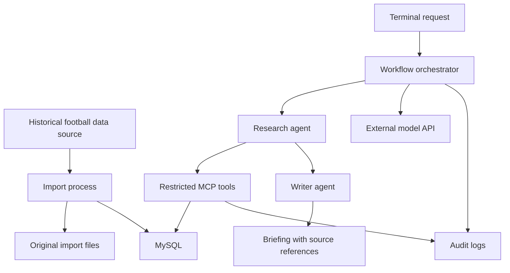

# Stillwater / Game Day 🏈

A Texas Longhorns football briefing app exploring historical data ingestion, multi-agent AI workflows, MCP tools, and secure access to MySQL.

This is the first project in **Project Stillwater**, a collection of hands-on projects exploring AI systems and secure software architecture. Developed collaboratively with OpenAI Codex, it combines AI-assisted planning, implementation, and review with human direction and verification. The goal is to build something useful while documenting the architecture, permissions, and engineering tradeoffs behind it.

## Status

**Planning and initial setup.** Features below describe the intended implementation.

## Project Goal

Build a terminal-based working prototype in approximately two weeks / 20–30 focused hours that:

- Imports multiple seasons of historical football data from one suitable source.
- Stores normalized data and source references in MySQL.
- Uses a research agent to retrieve facts through restricted MCP tools.
- Uses a writer agent to produce a briefing with evidence references.
- Demonstrates permitted access, blocked access, and handling of untrusted instructions.

Exact dataset coverage will depend on source availability, permitted use, and implementation time.

Version one uses one historical data source and a fixed sequential workflow. Live ingestion, a dashboard, S3, Athena, RDS, arbitrary SQL or shell tools, and infrastructure-changing agents are deferred. Reduce data coverage before expanding scope.

## Planned Architecture



Development begins locally on the developer’s Mac. The deployment target is a new Linux VM on a friend’s PC, with the application, import process, MCP service, and MySQL running together. Access will use Tailscale and SSH, with MagicDNS providing the VM’s hostname. MySQL will remain accessible only within that VM or its private container network. The orchestrator will invoke an external model API and run the research and writing stages sequentially.

The friend has authorized MySQL setup on the new VM. Provisioning and access details are pending; capacity and permission for other installs, including application components and VS Code Remote–SSH, must be confirmed before remote setup. The existing VM is separate from this planned host.

The research agent retrieves structured evidence through `list_games` and `get_game_data`. The writer receives that evidence and its source references without database or retrieval-tool access. The orchestrator controls the handoff, timeouts, and usage limits.

## Data Plan

Start with one season of schedules, game results, and team game statistics to validate the import, then expand historical coverage. Add player statistics if time and source coverage allow.

Imports will preserve original source files and track retrieval time, record counts, and failures. Repeat imports should update existing records without creating duplicates.

Keep original imports in a private local directory excluded from Git. Link normalized records to their source and import history, and preserve missing values as missing rather than treating them as zero.

## Security Approach

- Separate database identities for administration, ingestion, and retrieval.
- Give the MCP database identity read-only access to approved tables or views.
- Keep database credentials out of agent inputs and outputs; keep import and administrator credentials unavailable to the agent runtime.
- Expose bounded, parameterized retrieval tools rather than arbitrary SQL.
- Keep MySQL accessible only within the host or private container network.
- Exclude credentials, private configuration, and sensitive logs from Git.
- Treat retrieved notes as untrusted data.
- Record sanitized audit events, errors, timing, and model usage without exposing secrets in prompts or logs.

A controlled prompt-injection experiment in a harmless game note will test agent behavior. Separate database checks will verify that authorized reads succeed, private-table reads fail, and dataset writes fail under the MCP identity. Missing-data and repeated-import checks will verify application behavior and data integrity.

Database identities enforce database privileges, but services on one machine still share host-level risks. Separate operating-system users or containers may improve isolation; the implementation will document the limits of the chosen setup.

## Two-Week Milestones

| Days | Focus |
|---|---|
| 1–2 | Environment setup, source selection, schema, and permissions |
| 3–5 | Historical data ingestion and validation |
| 6–7 | MCP retrieval tools |
| 8–10 | Research and writer agents, sourced briefings, and logging |
| 11–12 | Security and failure-handling checks |
| 13–14 | Documentation, fixes, and demo |

## Definition of Done

- A repeatable import loads the agreed dataset and reports gaps.
- Two agents produce a briefing through restricted tools.
- Factual claims can be traced to source records.
- Missing information is reported rather than invented.
- Authorized reads succeed; unauthorized reads and writes fail.
- Sanitized logs make tool calls and workflow outcomes inspectable.
- Setup instructions, a sample sourced briefing, security-check results, and isolation limitations are documented.

## Development Setup

Design references: [schema draft](db/schema-draft.sql), [permission plan](docs/permissions.md), and [source validation](docs/source-validation.md). The schema and permission plan have not been deployed or enforcement-tested.

See the [project outline](docs/project-outline.md) for the detailed plan, security boundaries, learning approach, and next three implementation steps.

Python 3.13 is selected for implementation. Local setup has been verified with Python 3.13.16 on an Intel Mac. The model provider and football data source remain undecided; MySQL setup is still pending.

From the repository root, create and activate a project-specific virtual environment:

```bash
python3.13 -m venv .venv
source .venv/bin/activate
python --version
python -m pip --version
```

Create the environment once; activate it again in each new development terminal. The pip path should be inside this repository’s `.venv/`. Use `python -m pip` for package installation so it uses the selected interpreter. No application dependencies have been selected yet.

In VS Code, install the Python extension by Microsoft (`ms-python.python`), then run **Python: Select Interpreter** and choose `.venv/bin/python`.

Verify the terminal interpreter with:

```bash
python -c "import sys; print(sys.executable); print('Stillwater is ready')"
```

The executable path should point inside `.venv/`. The environment and generated Python bytecode are excluded from Git; dependencies will be declared separately so the environment can be recreated. Run `deactivate` to leave the environment.

The next steps are to establish the local development environment, validate a repeatable one-season import, and verify the restricted MCP tools before connecting the agents.

## Learning Notes

This repository will document architectural decisions, security-check results, and lessons learned. AI coding tools will assist development; changes will be reviewed and verified as part of the learning process.

Work in small steps: explain → try → inspect → review the diff → commit. Connect new concepts to familiar Java/MySQL work and verify both expected behavior and relevant failures.
