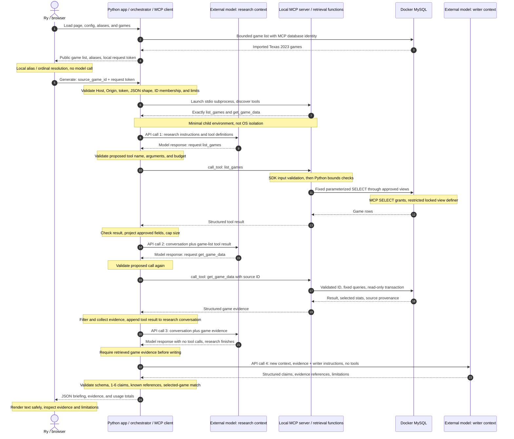
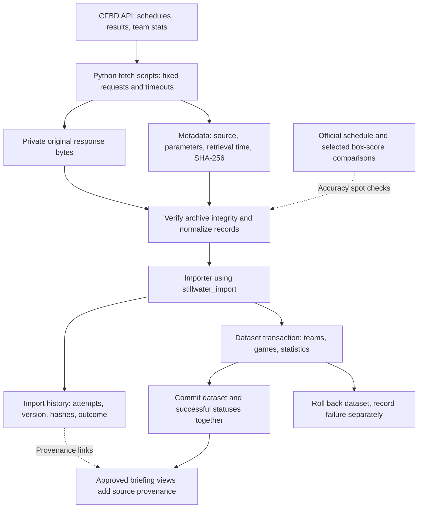
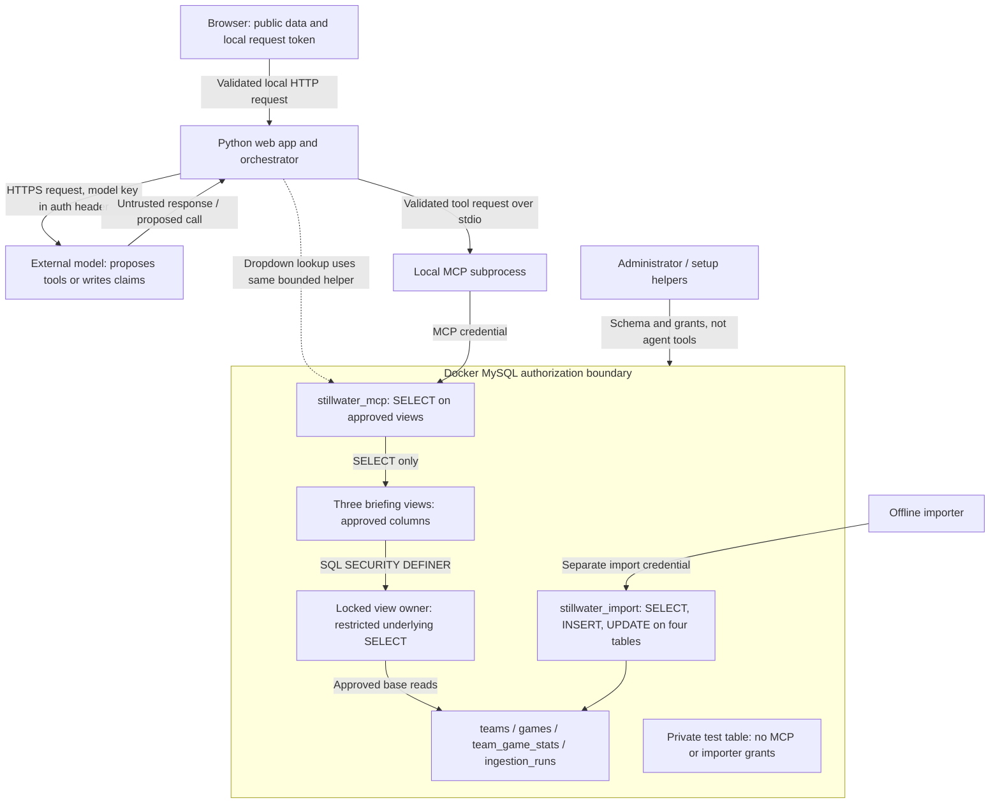

# Glass-to-Metal Architecture Review

For the shorter presentation cues, use the [demo presenter outline](demo-outline.md). This document is the deeper review and diagram reference.

Trace one Texas–Alabama briefing, CFBD game `401520183`, from the browser to stored records and back. Start the demonstration with the finished briefing, then explain the path that produced it. Data ingestion is a separate preparation path, not part of each generation.

The diagrams describe implemented code on `feature/local-web-ui`. Research and writer are two roles of the same external model, not two separately deployed models. The Python application controls execution and evidence handoff. A normal verified run used four model requests; other runs can differ within the limits.

## 1. Live request: glass to database and back

The browser's initial game-list request calls `list_games()` directly in Python; it does not go through a model or an MCP subprocess. Generated research uses the real MCP client/server protocol. Both retrieval paths use the MCP database identity and the same bounded queries.

Each arrow to a model is an external API request. Each arrow to MCP is a local protocol request, not a model API request. `await tools.call_tool(...)` initiates the MCP request and waits for its response; it is not waiting for the model to call Python directly. `tools` is our application-owned MCP client.

The research loop continues when a response requests a tool. It ends early when a response has no tool calls; it does not require the literal word DONE. After the bounded loop, existing evidence can be passed to the writer. Maximums: four research model requests, one writer request, four dispatched tools, and two collected evidence games. The web wrapper rejects a final result unless its sole evidence game matches the selected ID; current research is instructed to retrieve that game, not technically scoped to only that ID during every intermediate read.

### Operations, roles, and guardrails

| Step | Component and role | Important guardrails / practical limit | Code |
| --- | --- | --- | --- |
| 1 | Browser resolves school, nickname, or season order | Reviewed static aliases; reject ambiguous matches; client checks are bypassable | [game_search.js](../web/game_search.js), [team_aliases.json](../web/team_aliases.json) |
| 2 | Browser sends selected game ID | No model/database credential in browser; local token sent in header; no raw search text sent to model | [app.js](../web/app.js) |
| 3 | HTTP handler admits generation | Loopback only; exact Host/Origin and token; JSON only, 1,024-byte cap, one integer field, imported-ID membership; live mode opt-in | [web_app.py](../scripts/web_app.py): `do_POST` |
| 4 | Web server controls work | One generation at a time; ten-second cooldown; ten attempts per process start; neither user authentication nor hard dollar cap | [web_app.py](../scripts/web_app.py): `DemoServer`, `generate` |
| 5 | Orchestrator launches/discovers MCP | SDK client launches stdio server with minimal environment; exact tool-name set verified; same-user file access remains possible | [briefing.py](../scripts/briefing.py): `live`, `minimal_mcp_environment` |
| 6 | Model API adapter sends HTTPS request | Fixed endpoint, key only in auth header, owner-only key file, no redirects, 30-second request timeout, 1 MB response cap, no automatic retries | [model_api.py](../scripts/model_api.py) |
| 7 | Research model proposes tool use | Only two tool descriptions supplied; model does not execute code or possess DB credentials | [briefing.py](../scripts/briefing.py): `RESEARCH`, `TOOLS`, `payload` |
| 8 | Orchestrator approves and dispatches | Tool allowlist and strict argument schema before dispatch; call/payload/token limits; reject parallel calls | [briefing.py](../scripts/briefing.py): `run_workflow`, `Budget` |
| 9 | MCP server validates and invokes Python | Registered tools only; SDK validation uses strict integer/range annotations before function body | [mcp_server.py](../scripts/mcp_server.py) |
| 10 | Retrieval functions query MySQL | Repeat bounds checks for direct callers; fixed SQL and separate parameter tuples; Texas-only, limited rows, read-only transaction, 2-second SELECT hints, sanitized errors | [game_tools.py](../scripts/game_tools.py) |
| 11 | Connection helper authenticates | Reads MCP credential on this path; verifies actual DB identity and server version; loopback TCP 3307 to container 3306; connection/read timeouts | [local_db.py](../scripts/local_db.py), [compose.yaml](../compose.yaml) |
| 12 | MySQL authorizes access | MCP SELECT only on three views; view definitions expose approved fields; locked definer has restricted base reads; no private-table grants | [mcp-views.sql](../db/mcp-views.sql), [permissions.md](permissions.md) |
| 13 | Orchestrator receives and prepares evidence | Reject tool errors; approved field projection, result-size caps, missing flags, game evidence required; preserve provenance references | [briefing.py](../scripts/briefing.py): `public_evidence`, `run_workflow` |
| 14 | Writer model produces prose | Separate context with evidence, no tools or original request/research prose; instructed to ignore embedded instructions and disclose missing data | [briefing.py](../scripts/briefing.py): `WRITER`, `payload` |
| 15 | Application validates output | Structured shape, 1-6 claims, known evidence references, length limits, no writer tool calls; citation linkage is not semantic fact verification | [briefing.py](../scripts/briefing.py), [web_app.py](../scripts/web_app.py): `generate` |
| 16 | Browser displays result | `textContent` instead of HTML interpretation; CSP, local assets, labeled saved sample, evidence panel | [app.js](../web/app.js), [web_app.py](../scripts/web_app.py): `send` |
| Throughout | Application audit and budgets | Allowlisted metadata only, no raw prompts/responses/credentials; local ignored logs; reported-token checks after responses; overall workflow deadline 180 seconds | [briefing.py](../scripts/briefing.py): `Audit`, `Budget`; [web_app.py](../scripts/web_app.py): `generate` |

## 2. Data preparation: source to stored evidence

This happens before generation. A briefing does not fetch CFBD again or rerun the importer.

- **Normalization:** converts source formats to our schema, preserves missing as NULL, and checks relationships/ranges. Missing is not zero.
- **Identity and idempotency:** CFBD source IDs identify source entities; internal MySQL IDs link our rows. Unique source constraints and upserts prevent duplicate dataset identities on repeat imports. Import attempts still create new history rows; provenance can change, so “idempotent dataset” does not mean no database field ever changes.
- **Transactions:** earlier team/game writes roll back if a later statistics write fails in the same dataset transaction. A connection failure during COMMIT can leave the outcome uncertain; the importer does not falsely label that case a definite rollback.
- **Provenance:** preserved bytes and hashes support tracing/reprocessing. A hash verifies bytes against the recorded hash; it does not prove source authenticity, correctness, or correct normalization. Schedule/box-score comparisons and transformation tests provide different evidence.
- **Coverage:** Texas 2023, 15 teams, 14 games, 28 team-stat rows. Some records occur in January 2024 but belong to the 2023 season. Return/detailed defensive statistics are excluded; source accuracy was sampled rather than exhaustively established.

Code: [fetch_games.py](../scripts/fetch_games.py), [fetch_team_stats.py](../scripts/fetch_team_stats.py), [normalize_games.py](../scripts/normalize_games.py), [normalize_stats.py](../scripts/normalize_stats.py), [import_data.py](../scripts/import_data.py), [schema-draft.sql](../db/schema-draft.sql). Evidence: [source validation](source-validation.md), [database checks](local-database-checks.md).

## 3. Permissions and trust boundaries

The restricted view definer is not a database connection made by the agent: MySQL uses its privileges to evaluate definer views. View definitions choose exposed data; grants choose permitted operations. Views alone are not inherently read-only.

These are application/database permission boundaries, not complete process isolation. The web process and MCP subprocess run as the same OS user, and owner-only secret files do not isolate programs sharing that user. A compromised process or privileged Docker/host administrator can cross current host boundaries. Minimal environment prevents automatic secret-variable inheritance, not file reads. Model-facing tools expose no file, shell, or arbitrary SQL capability.

The HTTP token is generated in memory on each server start, fetched by same-origin JavaScript, and checked on generation requests alongside Origin. It protects against unwanted cross-site browser requests; it neither identifies a person nor prevents a local program from obtaining it. The service has no user login and remains localhost-only. VM/public access and OS-level credential isolation are deferred.

## What our evidence establishes

| Evidence | Establishes | Does not establish |
| --- | --- | --- |
| 41 Python tests, including HTTP boundaries | Tested code behavior on the included cases | Complete audit or all browser behavior |
| 102 query/alias cases plus order assertion | Reviewed lookup and collision behavior on tested inputs | General language understanding or every nickname |
| Real DB allowed/denied checks | Tested MySQL authorization boundaries | Model resistance to every injected instruction |
| Real MCP integration | Discovery, validation, and retrieval through stdio | Model factual accuracy |
| Live missing-statistics / injected-text cases | Observed correct behavior in scoped runs; one sparse-data bug fixed | Universal injection resistance |
| Manual comparison of live claims and evidence | Those sampled generated claims matched their evidence | Automatic semantic verification of all future output |
| UI feedback from Ry | Initial appearance and requested interaction changes reviewed | Automated responsive/keyboard/browser test coverage |

Details and run history: [security/failure checks](security-failure-checks.md), [model review](model-review.md), [UI guide](web-ui.md), [alias research](team-aliases.md). Timeouts stop waiting; an already-sent request can still be billed. There are no automatic retries and no implemented hard dollar cap.

## Short mentor explanation

“The model proposes actions; the application validates and executes them. MCP gives the application a standard interface to two bounded retrieval tools, and MySQL independently restricts the account to approved read-only views. A separate writer context receives structured evidence without tools; output checks enforce structure and citation linkage, while factual accuracy still needs evaluation.”

## Current Presentation Status

The interactive live-path walkthrough is complete; repeat an abbreviated pass and rehearse the [presenter outline](demo-outline.md). Ry requested and approved richer generated coverage: the writer now prefers 5–6 substantive claims when statistics support them, while preserving the 1–6 validator and all permission/budget boundaries. The most recent live sample was manually checked; earlier live injection/missing-data cases predate this prompt revision. Mermaid note semicolons were replaced after a reported parse error; automated diagram rendering remains unverified.
